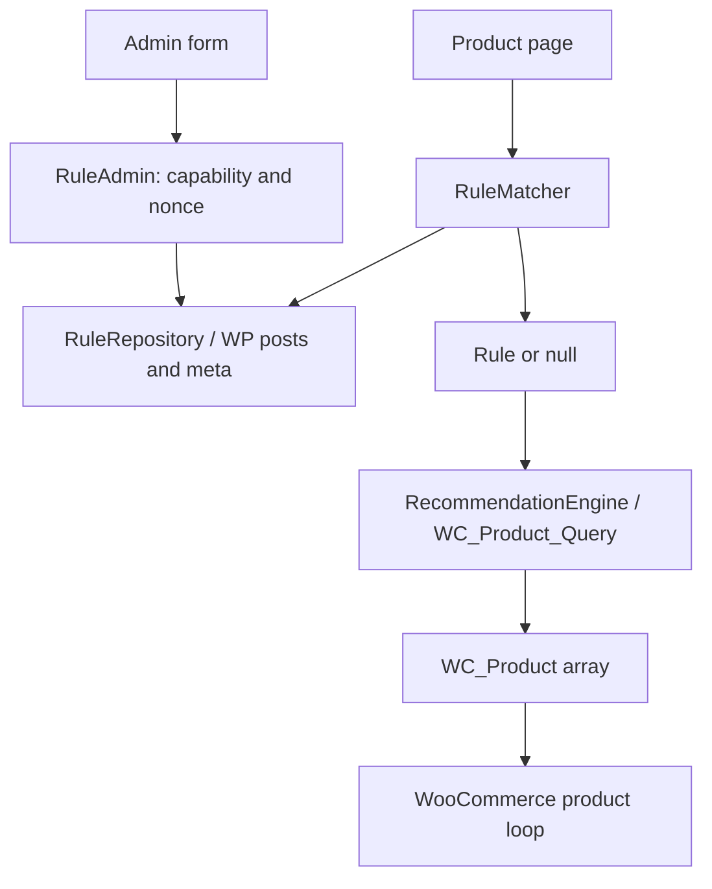

# معماری، داده و قراردادها

مرجع راهنما: [فهرست](README.md). تاریخ بازبینی: ۲۰۲۶-۱۰-۲۷. این سند کد فعلی و حدود شواهد اجرای محلی M0 تا M3 را توصیف می‌کند؛ وجود مسیر در source به‌تنهایی اثبات QA چندبستری نیست.

## نقشه فعلی

| مالک | مسئولیت |
|---|---|
| [ورودی](../hamkharid.php) | constants، اعلام HPOS، autoloader و اعلان خطای نبود آن |
| [Plugin](../src/Plugin.php) | `plugins_loaded` با priority=20؛ ترجمه، بررسی وجود کلاس WooCommerce، راه‌اندازی admin یا frontend |
| [RulePostType](../src/Rules/RulePostType.php) | CPT و schema متا؛ در `init` با priority=5 |
| [RuleRepository](../src/Rules/RuleRepository.php) | create/update/find/delete؛ واکشی صفحه‌بندی‌شده و ترتیب priority DESC سپس ID ASC در هر سطح |
| [RuleMatcher](../src/Matching/RuleMatcher.php) | تقدم دسته مستقیم، نزدیک‌ترین والد، اولویت و ID؛ عبور از مقصد حذف‌شده با سقف ۵۰۰ نامزد و diagnostics |
| [RecommendationEngine](../src/Recommendations/RecommendationEngine.php) | WC_Product_Query محدود، سه روش مرتب‌سازی، eligibility simple/variable و سیاست backorder تنظیم‌پذیر |
| [RuleAdmin](../src/Admin/RuleAdmin.php) | save_post، nonce، capability، notice، toggle و redirect |
| [RuleMetaBox](../src/Admin/RuleMetaBox.php) و [RuleListTable](../src/Admin/RuleListTable.php) | فرم و جدول بومی وردپرس |
| [DisplaySettings](../src/Admin/DisplaySettings.php) | تنظیمات versioned نمایش/عنوان/backorder/uninstall و preview فقط‌خواندنی؛ جست‌وجوی محصول برای کاربر مجاز |
| [ProductRecommendations](../src/Frontend/ProductRecommendations.php) | renderer مشترک برای hook خودکار، shortcode و dynamic block؛ تشخیص embed برای enqueue CSS و loop بومی WooCommerce |

## مدل داده فعلی

پیشوند واقعی جدول‌ها وابسته به نصب وردپرس است. افزونه جدول اختصاصی ندارد.

| داده | محل/نوع | معنا و قید فعلی |
|---|---|---|
| قانون | `posts`، `post_type=hamkharid_rule` | خصوصی؛ public/query/archive/REST غیرفعال؛ supports=title |
| شناسه و نام | `ID`، `post_title` | شناسه WP؛ نام با sanitize_text_field اعتبارسنجی می‌شود |
| وضعیت | `post_status` | `publish` فعال؛ `draft` غیرفعال؛ trash بومی WP |
| مبدأها | `_hamkharid_source_category` | integer تکرارشونده، single=false؛ termهای `product_cat` |
| مقصد | `_hamkharid_target_category` | integer، single=true؛ یک term معتبر |
| تعداد | `_hamkharid_recommendation_count` | integer، پیش‌فرض ۳؛ Rule مقدار را به بازه ۱ تا ۶ نرمال می‌کند |
| ترتیب | `_hamkharid_sort_strategy` | string: `random / newest / best_selling`؛ Rule مقدار نامعتبر را به random نرمال می‌کند |
| اولویت | `_hamkharid_priority` | integer در بازه ۰ تا ۱۰۰؛ rule قدیمی بدون meta برابر صفر است |
| تنظیمات نمایش | option=`hamkharid_display_settings_v1` | schema نسخه ۱؛ mode، placement، عنوان فارسی/انگلیسی، backorder و پاک‌سازی uninstall |

Repository نام خالی و نبود مبدأ/مقصد معتبر را با WP_Error رد می‌کند؛ مبدأهای نامعتبر را حذف می‌کند و اگر مورد معتبر باقی بماند ادامه می‌دهد. update ابتدا عنوان/وضعیت نوشته را می‌نویسد و سپس meta را جایگزین می‌کند؛ تضمین تراکنش چندنوشتنی ندارد. نادیده‌گرفتن خطای نوشتن meta بدهی فنی است (R-04).

## قراردادهای ارتباطی و رفتار فعلی

REST عمومی برای قواعد یا سرویس خارجی وجود ندارد. route محدود `hamkharid/v1/products` برای انتخاب محصول در editor/admin فقط به کاربر دارای `manage_woocommerce` یا `edit_products` پاسخ می‌دهد. مدیریت قانون بر hookهای WP، متدهای PHP و فرم بومی admin است.

- `RuleMatcher::match(int $product_id): ?Rule` و `match_with_diagnostics(int $product_id): array`؛ در هر specificity، اولویت DESC و ID ASC؛ مقصد حذف‌شده رد می‌شود تا قانون بعدی بررسی شود. پس از سقف ۵۰۰ نامزد reason=`candidate_limit_reached` گزارش می‌شود.
- `RecommendationEngine::recommend(int $current_product_id, Rule $rule): array`؛ خروجی محصولات منتشرشده، قابل‌نمایش و قابل‌خرید از نوع simple یا variable است. variation واجد شرایط و تنظیم backorder بررسی می‌شود؛ query محدود refill می‌کند و SQL RAND ندارد. علاوه بر بودجه ۵۰۰ محصول E-12، هر فراخوانی حداکثر ۵۰۰ variation را در صفحه‌های حداکثر ۲۴تایی بررسی می‌کند.
- `RuleRepository::create/update` خروجی `int|WP_Error` و `find` خروجی `?Rule` دارند. repository مجوز endpoint نیست؛ ورودی خارجی باید در controller احراز مجوز شود.
- `save_post_hamkharid_rule` به `RuleAdmin::save` متصل است؛ nonce فعلی `hamkharid_rule_nonce` برای action=`hamkharid_save_rule` و capability=`manage_woocommerce` است.
- toggle از `admin-post.php?action=hamkharid_toggle_rule&rule_id=...`، nonce متناسب با ID و redirect امن استفاده می‌کند. endpoint عمومی بدون احراز مجوز ندارد.
- errorهای repository: `hamkharid_rule_name_required`، `hamkharid_source_category_required`، `hamkharid_target_category_required` و `hamkharid_rule_not_found`. پیام ترجمه‌شده در UI؛ کد خطا برای منطق ثابت بماند.
- `do_action('hamkharid_loaded', $plugin)` بعد از boot وابستگی‌ها اجرا می‌شود؛ hook توسعه موجود است، تضمین نسخه‌بندی‌شده برای extensionها ارائه نشده.
- نمایش: `[hamkharid_complements]` و block=`hamkharid/complements` از renderer مشترک استفاده می‌کنند؛ `product_id` صریح و context محصول برای block پشتیبانی می‌شود. نصب تازه manual است؛ activation با rule موجود، نصب ارتقایافته را automatic نگه می‌دارد. حالت automatic دو placement دارد.
- renderer از `wc_get_template_part('content', 'product')` استفاده و globals/loop props را در finally بازیابی می‌کند؛ اولین خروجی موفق برای هر product ID در request نگه داشته می‌شود. CSS برای صفحه محصول و محتوای embed شناسایی‌شده enqueue می‌شود؛ این اسکن، اثبات سازگاری هر builder نیست.
- Preview مدیریت، نتیجه matcher و engine واقعی را بدون تغییر cart یا rule نشان می‌دهد؛ reasonهای matcher شامل invalid product، no match، invalid target و سقف rule scan است. diagnostics موتور پیشنهاد تعداد variationهای بررسی‌شده و رسیدن به سقف را ثبت می‌کند؛ preview وقتی به سقف می‌رسد هشدار می‌دهد که برخی variable productها ممکن است حذف شده باشند.
- عنوان فروشگاه از locale جاری و overrideهای `title_fa`/`title_en` می‌آید؛ متن پیش‌فرض انگلیسی `Complete your purchase` و فایل ترجمه فارسی منبع متن fa_IR است.

## قراردادهای هدف و محدودیت‌های تأیید

مالک معیارهای پذیرش [PRD](prd-fa.md) است. موارد زیر پیاده‌سازی شده‌اند اما بخشی از پذیرش runtime آن‌ها باز است:

1. FR-02: POST نامعتبر در مسیر admin رد می‌شود؛ snapshot پیش از native post update، عنوان/status و meta معتبر قبلی را حفظ می‌کند و مقدارهای ارسال‌شده را برای همان مدیر بازمی‌گرداند. آزمون integration مسیر update و E2E CRUD/حفظ فرم اجرا شده‌اند؛ خطای نوشتن چند meta همچنان تراکنش اتمیک ندارد.
2. ذخیره عنوان/status و چند meta یک تراکنش واحد نیست؛ همه خطاهای meta-write به‌طور کامل مدیریت نمی‌شوند. atomic بودن ذخیره ادعا نشود.
3. Matcher سقف ۵۰۰ rule candidate دارد؛ `candidate_limit_reached` در preview آشکار می‌شود. این سقف با سقف جداگانه ۵۰۰ variation در هر `recommend()` اشتباه نشود. ماتریس performance و stress ثبت شده و NFR-02 فقط در envelope محلی E-15 پاس است؛ به SLA عمومی/محصولی تعمیم ندارد.
4. تنظیمات فعلی در option نسخه‌دار `hamkharid_display_settings_v1` است؛ نصب تازه manual، و activation با rule موجود automatic را انتخاب می‌کند. M4 برای ZIP SHA-256 `7f4868b8bd54fd772d4bbf5fb8c5ef6044b4c028baf8c9de400c270dc62f884b` در clone QA پاس شد: manifest/reproducibility، نصب و جایگزینی از مسیر WordPress `Plugin_Upgrader`، shortcode پس از request تازه، update شبیه‌سازی‌شده با header marker `0.0.9`، uninstall پیش‌فرض و opt-in، rollback snapshot و پاک‌سازی fixtureها. rollback snapshot شامل ۵۳ جدول و ۴۷۰۲ ردیف بود و clone به baseline برگشت. downgrade با ZIP تاریخی واقعی انجام نشد؛ مسیر uploader مرورگر آزموده نشد.
5. بلوک `hamkharid/complements` در editor از REST محدود محصول استفاده می‌کند و در frontend از callback سمت سرور. E2E run=`1aa89a2c28a1` درج/نمایش بلوک و دسترسی Shop Manager به rules/settings را بررسی کرد؛ Browser QA ۱۷/۱۷، از جمله axe-core 4.13.0 در LTR/RTL، پاس شد. اجرا پیش از commit `5d468e0` بود و با منطق تست commit‌شده یکسان است، جز whitespace اصلاح‌شده با PHPCBF. این بررسی جای screen reader یا ماتریس کامل themeها را نمی‌گیرد.
6. enqueue پیش از head، محتوای پست، metaهای با کلید شناخته‌شده builder و widgetهای فعال text/custom HTML/block را بررسی می‌کند. smoke ناحیهٔ widget موجود و multi-embed اجرا شده‌اند. با source جاری، Elementor 4.3.5 Shortcode widget در صفحهٔ معمولی از UI ساخته/ذخیره و در frontend render شد، اما فقط پس از shim محلی QA برای autoload داخلی MCP؛ نصب clean/default هنوز با REST/MCP fatal محدود است. SiteOrigin Page Builder 2.38.0 در Classic Page Builder، Text widget را با مسیر Code→Visual ذخیره کرد؛ پس از reload shortcode باقی ماند و frontend یک section/سه کارت/سه CTA، CSS 200 و بدون خطای صفحه render شد. این شاهد مسیر Gutenberg Layout Block UI را پوشش نمی‌دهد. Elementor Theme Builder طبق تصمیم کاربر آزموده‌نشده می‌ماند؛ این probeها ادعای سازگاری جامع builderها نیستند.

### قرارداد embed پیاده‌شده و QA باز

- شورت‌کد `[hamkharid_complements]` و بلوک پویا `hamkharid/complements` adapterهای renderer مشترک‌اند. هر دو `product_id` صریح را می‌پذیرند؛ block از context محصول نیز استفاده می‌کند.
- نمونه صفحه مستقل: `[hamkharid_complements product_id="123"]`. نبود context یا محصول معتبر خروجی خالی می‌دهد.
- حالت manual hookهای خودکار را خاموش می‌کند. حالت automatic جایگاه `after_summary` یا `after_add_to_cart` دارد؛ فقط موفقیت QA چند قالب، دامنه سازگاری واقعی را تعیین می‌کند.
- برای جلوگیری از خروجی تکراری، اولین render موفق هر product ID در request باقی می‌ماند؛ بنابراین چند embed برای یک محصول در یک request همگی خروجی مستقل نمی‌دهند. این رفتار باید در راهنمای درج روشن باشد.
- Preview مدیریت از همان matcher/engine استفاده می‌کند و cart یا rule را تغییر نمی‌دهد. endpoint جست‌وجوی محصول محدود و capability-protected است.

## مرز توسعه و کارایی

- قیمت، مالیات، variation، cart و سفارش مالک WooCommerce هستند؛ SQL مستقیم سفارش، تغییر قیمت یا ثبت سفارش وارد این دامنه نمی‌شود.
- حفظ CPT/APIهای WP/WC طبق E-01. interface یا لایه جدید فقط برای مصرف واقعی مشترک preview/storefront ایجاد شود؛ framework موازی لازم نیست.
- engine در صفحه‌های حداکثر ۲۴ محصول می‌خواند و برای یک نتیجه حداکثر ۵۰۰ محصول را بررسی می‌کند (E-12). جداگانه، مجموع variation candidateهای بررسی‌شده در هر فراخوانی `recommend()` نیز حداکثر ۵۰۰ است (E-13)؛ diagnostics این سقف را اعلام می‌کند و preview برای نتیجهٔ احتمالی ناقص هشدار می‌دهد. regression مصنوعی ۵۰۱ variation در `integration-performance` با `composer run test:all` در ۲۰۲۶-۱۰-۲۸ پاس شد. ماتریس ۱k/۱۰k/۵۰k و variable stress نیز اجرا شد؛ NFR-02 طبق E-15 فقط در محیط محلی اندازه‌گیری‌شده پاس است، نه SLA عمومی. random از صفحه‌های منتخب نمونه‌گیری می‌کند و ORDER BY RAND ندارد؛ count/offset بزرگ همچنان هزینه دارند و شمار queryهای WC_Product_Query با کل SQLها برابر نیست.
- کش دائمی و schema اختصاصی تا اثبات نیاز به تعویق می‌افتند. کش request-level می‌تواند نتیجه تکراری را حذف کند. کش آینده ترجیحاً IDها را نگه دارد، نه HTML قیمت؛ locale، تنظیمات، قواعد، تغییر محصول/term/موجودی و contextهای قیمت باید لحاظ شوند.
- option تنظیمات با `autoload=false` ذخیره می‌شود؛ benchmark شامل matrix ۱۰/۱۰۰/۱۰۰۰ rule شد و گیت performance محلی E-15 را پاس کرد. رفتار روی میزبان‌ها یا مجموعه‌داده‌های دیگر تأیید نشده است.
- `uninstall.php` با `clear_data_on_uninstall` انتخابی، ruleها و option هم‌خرید را پاک می‌کند؛ ZIP جاری با SHA ثبت‌شده در [گزارش QA پایلوت](pilot-qa-fa.md) روی clone lifecycle را گذراند: default uninstall داده‌های افزونه/WooCommerce را حفظ کرد و opt-in فقط rule/settings را حذف کرد. rollback محافظت‌شده snapshot ۵۳ جدول/۴۷۰۲ ردیف را برگرداند؛ markerهای QA صفر، plugin فعال و تنظیم mode=`manual` شد. کنتراست کارت/دکمه 9.3608:1 اندازه‌گیری شد. native RTL با language pack رسمی `fa_IR` و `WPLANG=fa_IR` نیز در clone تأیید شد؛ UI uploader مرورگر آزموده نشد.
